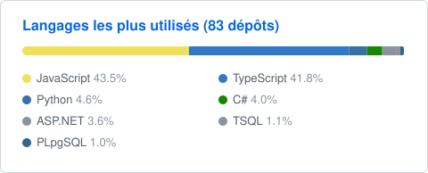

# Kevin Priotti

Développeur full-stack senior, plus de 20 ans d'expérience.
Je conçois et je livre des applications web et mobiles de bout en bout, du back-end à l'infrastructure.

### Stack

### Activité

La plupart de mes projets sont privés (clients et produits). Les statistiques ci-dessous incluent ces dépôts, sans en exposer le code.

